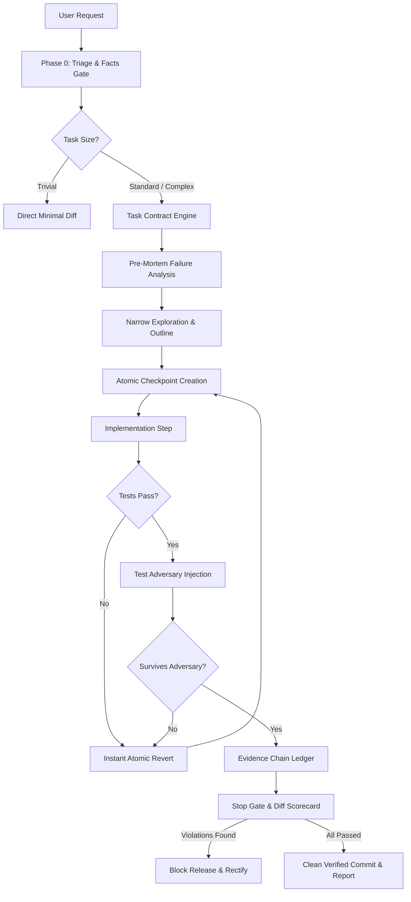

# System Architecture: master-skill / safety

This document specifies the internal architecture, state transitions, security boundary rules, and runtime verification protocols of the **master-skill / safety** autonomous agent governance engine.

---

## 1. High-Level Architectural Model

Standard generative AI coding agents operate as unconstrained token generators. They execute tools, patch files, and assert completion based solely on model confidence.

**master-skill / safety** converts AI coding agents from unconstrained generators into **sandboxed, deterministic software engineers** governed by strict kernel contracts, adversarial testing, evidence trails, and cryptographic verification gates.



---

## 2. The 6-Stage Governance Pipeline

### Stage 1: The Triage & Fact Engine (Phase 0)
Before any file or repository modification is permitted, the agent must emit a deterministic classification line:
```text
[ACCESS read|write][RUN interactive|headless][SIZE trivial|standard|complex][SHELL pwsh|ps51|cmd|posix]
```
- **Read-Only Mode**: Write tools are hard-disabled; git status and code inspection only.
- **Baseline Ledger**: Records existing failing (`KNOWN-RED`), flaky (`FLAKY`), and passing (`GREEN`) tests. The agent is strictly accountable for *new* regressions only.
- **Memory Sync**: Probes `.master-skill/memory.json` to recall established architectural decisions and framework quirks.

---

### Stage 2: The Task Contract Engine
For any standard or complex task, an immutable JSON contract is registered:
- **`permitted_paths`**: Glob patterns of directories and files the agent may modify.
- **`forbidden_paths`**: Protected directories (e.g. `prod/`, `secrets/`, lockfiles) that trigger immediate failure if touched.
- **`architectural_invariants`**: Explicit constraints (e.g. "no circular imports", "mutations wrapped in DB transaction", "strict type safety").
- **`verification_targets`**: Test commands that must pass with exit code `0`.

---

### Stage 3: Atomic Checkpoints & Failsafe Rollbacks
- Before touching code, a clean git checkpoint or working-tree reference is recorded.
- Implementation proceeds in single atomic slices.
- If an atomic step fails validation, the agent **never stacks patches**. It immediately executes an atomic revert back to the checkpoint, analyzes the root cause, and retries with a clean baseline.
- **Circuit Breaker**: If 3 consecutive approaches fail, the agent stops, logs an architectural barrier, and presents the 1-Screen Decision Matrix to the user.

---

### Stage 4: The Test Adversary
Passing happy-path unit tests is insufficient proof. The Test Adversary injects:
1. **Network Chaos**: Simulated 500ms latency, socket timeouts, and intermittent packet drops.
2. **Data Poisoning**: Extreme boundary inputs (empty arrays, oversized strings, null values, malformed JSON).
3. **Concurrency Races**: Parallel asynchronous invocations testing thread safety, atomicity, and mutex locks.

---

### Stage 5: The Immutable Evidence Ledger
Every tool execution, command exit code, and test log is appended to a structured JSONL ledger:
```json
{"id": "EV-001", "type": "TEST", "cmd": "npm test", "exit_code": 0, "hash": "sha256-..."}
```
Every assertion in the final report must cite a verified Evidence ID (`[EV-xxx]`). Claims without evidence citations are rejected by the governance engine.

---

### Stage 6: The Stop Gate
A final automated inspection validates:
1. **Zero Leftover Tags**: Ensures no temporary `DEBUG-CT` instrumentation remains.
2. **Contract Compliance**: Validates that all changed files exist strictly within `permitted_paths`.
3. **Documentation Sync**: Ensures `.env.example`, OpenAPI specs, and READMEs are updated alongside code changes.
4. **Diff Efficiency Scorecard**: Computes change ratio ($Added + Deleted) / Net Change$ to guard against unnecessary file bloat.

---

## 3. Directory Layout & Contract Reference

```text
dragonkrishnan15/safety
├── .master-skill/
│   └── memory.json             # Persistent cross-session knowledge & architectural decisions
├── adapters/                   # Native instructions for all AI IDEs & CLI agents
│   ├── AGENTS.md               # Antigravity IDE, Codex, Devin, DeepSeek
│   ├── CLAUDE.md               # Claude Code & Desktop
│   ├── COPILOT.md              # GitHub Copilot custom instructions
│   ├── .cursorrules            # Cursor IDE MDC rules
│   ├── .windsurfrules          # Windsurf IDE rules
│   └── .clinerules             # Cline & Roo Code
├── examples/                   # Canonical reference implementations & schemas
├── references/                 # In-depth architectural rulebooks & policies
├── scripts/                    # Zero-dependency governance & verification scripts
│   ├── stop_gate.ps1 / .sh     # Pre-commit quality & invariant gate
│   ├── memory_sync.ps1 / .sh   # Persistent memory recorder
│   ├── leftover_check.ps1 / .sh# Temporary tag scanner
│   └── scorecard.ps1 / .sh     # Diff health & ratio analyzer
├── templates/                  # Production-ready contract & adversary templates
├── AGENT_INSTALL.md            # Zero-friction agent auto-installation matrix
├── install.ps1                 # Windows PowerShell installer
├── install.sh                  # macOS / Linux / WSL POSIX installer
├── master-skill.md             # Standalone rulebook definition
├── README.md                   # Complete developer & community documentation
└── SKILL.md                    # Canonical agent skill declaration
```
