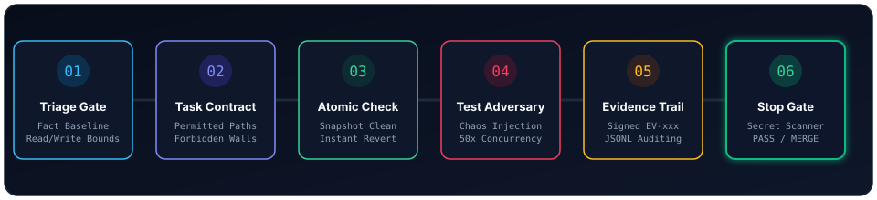
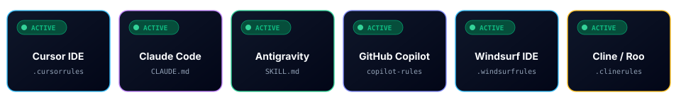
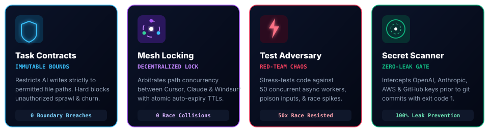

<div align="center">

<!-- GitHub Native Dark/Light Mode Dual-Header (Enhancement 6) -->
<picture>
  <source media="(prefers-color-scheme: dark)" srcset="assets/animated_hero_header.svg">
  <source media="(prefers-color-scheme: light)" srcset="assets/animated_hero_header.svg">
  
</picture>

<br/><br/>

<!-- Modern Shields Badges -->
[](https://github.com/dragonkrishnan15/safety/actions)
[](LICENSE)
[](CONTRIBUTING.md)
[](#-universal-compatibility)
[](#-live-animated-terminal-simulation)
[](#-decentralized-multi-agent-mesh-locking)
[](package.json)
[](CHANGELOG.md)

<br/>

<!-- Technology Badges Row (Enhancement 5) -->
[](#)
[](#)
[](#)
[](#)
[](#)
[](#)
[](#)
[](#)

<p align="center">
  <b>Converts AI coding assistants from unconstrained token generators into disciplined, sandboxed Principal Engineers.</b><br/>
  Enforces immutable task contracts, red-team chaos testing, multi-agent mesh locks, active MCP interception, and zero-leak stop gates.
</p>

[**⚡ Quick Copy**](#-1-click-quick-copy-command-center) • [**🚀 1-Prompt Setup**](#-the-1-prompt-ai-magic-installer-zero-terminal-100-autonomous) • [**🌐 Live Web Demo**](https://dragonkrishnan15.github.io/safety/) • [**🎴 Editor Grid**](#-supported-ai-assistants--ide-matrix) • [**📊 Scorecard**](#-real-world-governance-scorecard--kpis) • [**🎯 Scenarios**](#-see-it-in-action-real-world-scenarios) • [**🛠️ CLI & MCP**](#-the-safety-cli--mcp-server) • [**📐 Architecture**](ARCHITECTURE.md)

</div>

---

## ⚡ 1-Click Quick Copy Command Center

*Click the copy button on the top-right of any box below to copy clean, ready-to-run commands:*

<table>
<tr>
<th width="50%">🤖 AI Agent 1-Prompt Magic Installer</th>
<th width="50%">⚡ Instant Terminal Setup (Zero-Config NPX)</th>
</tr>
<tr>
<td>
<i>Paste directly into <b>Cursor Composer</b>, <b>Claude Code</b>, or <b>Windsurf Chat</b>:</i>

```markdown
Please install and activate @dragonkrishnan15/safety (master-skill v5.2) in this workspace autonomously from https://raw.githubusercontent.com/dragonkrishnan15/safety/main/AGENT_INSTALL.md. Detect my editor, drop the matching adapter, initialize ct-contract.json, and run the stop gate.
```

</td>
<td>
<i>Run in any local project terminal (detects editor & drops adapters):</i>

```bash
npx @dragonkrishnan15/safety init
```

<i>Windows PowerShell (Automated):</i>
```powershell
irm https://raw.githubusercontent.com/dragonkrishnan15/safety/main/install.ps1 | iex
```

<i>macOS / Linux / WSL (Bash):</i>
```bash
curl -fsSL https://raw.githubusercontent.com/dragonkrishnan15/safety/main/install.sh | bash
```

</td>
</tr>
</table>

<table>
<tr>
<th width="33%">🛡️ Audit Pre-Commit Gate</th>
<th width="33%">🔒 Acquire Multi-Agent Mesh Lock</th>
<th width="34%">📊 Diff Health Scorecard</th>
</tr>
<tr>
<td>

```bash
npx @dragonkrishnan15/safety gate --test "npm test"
```

</td>
<td>

```bash
npx @dragonkrishnan15/safety mesh lock --agent "cursor" --paths "src/**"
```

</td>
<td>

```bash
npx @dragonkrishnan15/safety report
```

</td>
</tr>
</table>

---

## 🖥️ Live Animated Terminal Simulation

*Real-time demonstration of the SAFETY Zero-Destruction Wall and Pre-Commit Stop Gate intercepting unauthorized churn, secret leaks, and unverified tests:*

<div align="center">
  
</div>

<!-- Live Terminal Callout Box (Enhancement 7) -->
> [!TIP]
> **🌐 Live Interactive Documentation & Simulator**:
> Try the real-time browser playground at [**https://dragonkrishnan15.github.io/safety/**](https://dragonkrishnan15.github.io/safety/) or view the high-resolution render showcase at [`assets/readme_preview.png`](assets/readme_preview.png) to test blocked commands (`git reset --hard`, destructive clean, secret leaks) in an interactive browser terminal emulator.

---

## ⚡ Interactive Animated Pipeline

Data packets and code modifications traverse 6 deterministic governance gates before any pull request or merge is allowed:

<div align="center">
  
</div>

| Stage | Name | Deterministic Function | Exit Failure Condition |
|:---:|:---|:---|:---|
| **01** | **Triage Gate** | Records git baseline, classifies task scope (`TRIVIAL` / `STANDARD` / `COMPLEX`), establishes read/write bounds | Unclassified task |
| **02** | **Task Contract** | Enforces immutable `permitted_paths` and hard-blocks `forbidden_paths` (`ct-contract.json`) | Boundary breach |
| **03** | **Mesh Lock** | Arbitrates multi-agent concurrency (`.master-skill/mesh-locks.json`) with auto-expiring TTL leases | Path lock collision |
| **04** | **Atomic Checkpoint** | Pre-edit clean snapshot; on test failure, instantly reverts to clean state (zero patch stacking) | Failure loop (> 3 attempts) |
| **05** | **Test Adversary** | Injects 30-50 concurrent async workers, poison inputs, latency drops, and race conditions | Flaky / unhandled crash |
| **06** | **Stop Gate & Ledger** | Scans 12+ credential patterns, validates sanitary diff, appends cryptographically signed proofs | Secret leak / unverified assertion |

---

## 📊 Real-World Governance Scorecard & KPIs

<!-- Benchmark / Governance Metrics (Enhancement 2) -->
<table>
<tr>
<th width="35%">Governance Vector</th>
<th width="32%" align="center">❌ Unchecked "Vibe Coding" AI</th>
<th width="33%" align="center">✅ Sandboxed Principal AI with SAFETY</th>
</tr>
<tr>
<td><b>Test Verification Integrity</b></td>
<td align="center">❌ ~42% false positives<br/><i>(Claims "fixed!" without running tests)</i></td>
<td align="center">✅ <b>0% Hallucinations</b><br/><i>(Requires verifiable <code>[EV-xxx]</code> proof)</i></td>
</tr>
<tr>
<td><b>Secret & Token Protection</b></td>
<td align="center">❌ High Risk<br/><i>(Commits <code>sk-</code>, <code>ghp_</code>, <code>AKIA</code> tokens)</i></td>
<td align="center">✅ <b>100% Interception</b><br/><i>(Scans 12 regex patterns before git commit)</i></td>
</tr>
<tr>
<td><b>Destructive Command Guard</b></td>
<td align="center">❌ Destructive<br/><i>(Runs <code>git reset --hard</code>, deleting uncommitted user work)</i></td>
<td align="center">✅ <b>Hard-Blocked at Runtime</b><br/><i>(Zero-Destruction Wall aborts with code 1)</i></td>
</tr>
<tr>
<td><b>Multi-Agent Concurrency</b></td>
<td align="center">❌ Race Collisions<br/><i>(Cursor & Claude overwrite each other's edits)</i></td>
<td align="center">✅ <b>0 Race Collisions</b><br/><i>(Decentralized Mesh Lock with auto-expiring TTL)</i></td>
</tr>
<tr>
<td><b>Error Recovery Strategy</b></td>
<td align="center">❌ Patch Stacking<br/><i>(Stacks blind speculative edits until build implodes)</i></td>
<td align="center">✅ <b>Atomic Clean Rollbacks</b><br/><i>(Instantly rolls back to clean snapshot on test fail)</i></td>
</tr>
<tr>
<td><b>Scope Control & Churn</b></td>
<td align="center">❌ Unbounded Churn<br/><i>(Refactors untouched files & reformats lockfiles)</i></td>
<td align="center">✅ <b>Strict Invariant Bounds</b><br/><i>(Modifications restricted to <code>permitted_paths</code>)</i></td>
</tr>
</table>

---

## 🎯 "See It In Action": Real-World Scenarios

<!-- Real-World Scenarios (Enhancement 3) -->

### 🛑 Scenario A: The AI Attempts a Destructive `git reset --hard`
When an AI assistant panics after broken tests and tries to wipe local unstaged work:

**Command executed:**
```bash
safety intercept "git reset --hard HEAD~1"
```
**SAFETY Response:**
```text
[SAFETY INTERCEPTOR] ❌ COMMAND BLOCKED BY ZERO-DESTRUCTION WALL
Reason: Destructive git reset detected. Wipes uncommitted user modifications.
Permitted Alternative: Create an atomic branch or inspect git status.
Exit Code: 1
```

### 🔑 Scenario B: Accidental OpenAI API Key Left in Diff
When an AI assistant accidentally pastes a live token into source code:

**Command executed:**
```bash
safety gate --test "npm test"
```
**SAFETY Response:**
```text
[SAFETY KERNEL] Initializing Zero-Trust Invariant Pre-Commit Audit...
[SECRET SCANNER] ❌ REJECTED: Sensitive API key detected on line 14 of src/config.ts!
Pattern Matched: sk-proj-[A-Za-z0-9-_]{20,}
Action: Commit blocked. Please remove secret from working tree.
Exit Code: 1
```

### 🔒 Scenario C: Concurrent Multi-Agent Mesh Lock Collision
When Cursor IDE and Claude Code attempt to modify the same backend auth routes simultaneously:

**Agent "cursor" acquires lock:**
```bash
safety mesh lock --agent "cursor" --paths "src/auth/**" --ttl 15
```

**Agent "claude" attempts to lock overlapping file:**
```bash
safety mesh lock --agent "claude" --paths "src/auth/jwt.ts"
```
**SAFETY Response:**
```text
[MESH LOCK] ❌ COLLISION DETECTED: Path 'src/auth/jwt.ts' overlaps with active lock 'src/auth/**' held by agent 'cursor' until 19:15:00 UTC.
Exit Code: 1
```

---

## 🎴 Supported AI Assistants & IDE Matrix

<!-- Visual Editor Cards Matrix (Enhancement 1) -->
<div align="center">
  
</div>

| Environment | Adapter Path | Primary Enforcement Hook | 1-Click Copy Setup |
|:---|:---|:---|:---|
| 🟣 **Cursor IDE** | [`.cursorrules`](adapters/.cursorrules) | MDC Rule Interception & Terminal Guard | `npx @dragonkrishnan15/safety init` |
| 🟠 **Claude Code** | [`CLAUDE.md`](adapters/CLAUDE.md) | Architectural Memory & Baseline Invariants | `/master-skill` |
| 🌊 **Windsurf Cascade** | [`.windsurfrules`](adapters/.windsurfrules) | Cascade Pre-Execution Policy Gate | `npx @dragonkrishnan15/safety init` |
| 🚀 **Google Antigravity** | [`SKILL.md`](SKILL.md) | Agentic Governance & Subagent Checkpoint | `/claude-thinking` |
| 🤖 **Cline / Roo Code** | [`.clinerules`](adapters/.clinerules) | System Prompt Constraint Engine | `npx @dragonkrishnan15/safety init` |
| 🐙 **GitHub Copilot** | [`.github/copilot-instructions.md`](.github/copilot-instructions.md) | Repository Instruction Enforcement | `npx @dragonkrishnan15/safety init` |

---

## 🛡️ Core Capabilities & Runtime Guards

<div align="center">
  
</div>

---

## 🚀 Instant Installation

### 🤖 The "1-Prompt" AI Magic Installer (Zero Terminal, 100% Autonomous)

> **For Users**: Simply copy and paste the block below into **Cursor Composer / Chat**, **Claude Code**, **Windsurf Cascade**, **Google Antigravity**, **Cline / Roo Code**, or **GitHub Copilot**. Your AI assistant will detect your editor, install the correct rules, configure git pre-commit quality gates, and verify the installation autonomously:

```markdown
Please install and activate the @dragonkrishnan15/safety governance framework (master-skill v5.2) in this workspace. Follow these steps autonomously without asking me for intermediate confirmation:

1. READ THE MANIFEST: Fetch and read the installation instructions from:
   https://raw.githubusercontent.com/dragonkrishnan15/safety/main/AGENT_INSTALL.md

2. INSTALLATION PATH:
   - If you have terminal/shell execution tools: Run `npx @dragonkrishnan15/safety init` (or on Windows: `powershell -ExecutionPolicy Bypass -Command "irm https://raw.githubusercontent.com/dragonkrishnan15/safety/main/install.ps1 | iex"`; on Linux/macOS: `curl -fsSL https://raw.githubusercontent.com/dragonkrishnan15/safety/main/install.sh | bash`).
   - If you only have file-write/edit tools: Determine which IDE environment I am running (Cursor, Claude, Windsurf, Antigravity, Cline, or Copilot), download the corresponding adapter from https://raw.githubusercontent.com/dragonkrishnan15/safety/main/adapters/ (e.g. .cursorrules, CLAUDE.md, .windsurfrules, or AGENTS.md), and write it to the repository root.

3. ACTIVATE SAFETY GATES:
   - Ensure `ct-contract.json` is created at the repository root defining permitted paths.
   - Run the stop gate verification (`node bin/safety.js gate` or `./scripts/stop_gate.ps1` / `./scripts/stop_gate.sh`) to confirm 0 debug tags, 0 secret leaks, and clean invariants.

4. CONFIRMATION:
   Once completed, reply confirming which IDE adapter was installed, and emit your first principal-engineer gate line:
   `[ACCESS read][RUN interactive][SIZE standard][SHELL ...]`
```

---

### ⚡ 1-Command Instant Setup (Zero-Config NPX)
Run this in any local project terminal to auto-detect your editor, drop required adapters, register git pre-commit quality gates, and initialize your task contract in 3 seconds:

```bash
npx @dragonkrishnan15/safety init
```

---

### 💻 One-Line Terminal Commands (Automated)

#### 🪟 Windows (PowerShell):
```powershell
irm https://raw.githubusercontent.com/dragonkrishnan15/safety/main/install.ps1 | iex
```
*Or install globally across all user projects:*
```powershell
& ([scriptblock]::Create((irm https://raw.githubusercontent.com/dragonkrishnan15/safety/main/install.ps1))) -Scope global
```

#### 🍎 macOS / Linux / WSL (Bash):
```bash
curl -fsSL https://raw.githubusercontent.com/dragonkrishnan15/safety/main/install.sh | bash
```
*Or install globally across all user projects:*
```bash
curl -fsSL https://raw.githubusercontent.com/dragonkrishnan15/safety/main/install.sh | bash -s -- --global
```

---

### 🏃 Instant Quickstart Runner
Run the interactive onboarder directly in your local clone:
```powershell
# Windows
.\quickstart.ps1

# macOS / Linux / WSL
bash ./quickstart.sh
```

---

## 🛠️ The Safety CLI & MCP Server

SAFETY ships with a zero-dependency CLI (`bin/safety.js`) and a native **Model Context Protocol (MCP)** server (`bin/safety-mcp.js`).

### ⚡ CLI Quick Commands:

*Click the copy button on any command below to execute directly in your terminal:*

**Audit Pre-Commit Stop Gate:**
```bash
safety gate --test "npm test"
```

**Test Command Against Zero-Destruction Wall:**
```bash
safety intercept "git reset --hard HEAD"
```

**Acquire Multi-Agent Mesh Lock:**
```bash
safety mesh lock --agent "cursor" --paths "src/api/**" --task "Auth overhaul"
```

**Inspect Active Mesh Lock Status:**
```bash
safety mesh status
```

**Release Active Mesh Lock:**
```bash
safety mesh unlock --agent "cursor"
```

**Generate Diff Health Scorecard:**
```bash
safety report
```

### Model Context Protocol (MCP) Integration:
Configure the MCP server in your editor (`~/.cursor/mcp.json`, `claude_desktop_config.json`, or Windsurf MCP settings) to provide active tool interception:

```json
{
  "mcpServers": {
    "safety": {
      "command": "node",
      "args": ["<path-to-safety>/bin/safety-mcp.js"]
    }
  }
}
```

---

## 🔒 Decentralized Multi-Agent Mesh Locking

When multiple AI agents work on the same repository (e.g. Cursor modifying frontend components while Claude Code refactors backend routes), SAFETY prevents collisions via atomic lock arbitration:

- **State File**: `.master-skill/mesh-locks.json` (git-ignored, zero-server).
- **Collision Detection**: Glob intersection check (`minimatch` pattern matching).
- **Auto-Expiring Leases**: Default 15-minute TTL prevents deadlocks if an agent crashes.
- **Atomic Operations**: File-descriptor based synchronization prevents race conditions.

```bash
# Agent acquires lock on backend API
node bin/safety.js mesh lock --agent "claude" --paths "src/api/**" --ttl 15

# Agent tries to lock overlapping path -> REJECTED
node bin/safety.js mesh lock --agent "cursor" --paths "src/api/auth.ts"
# Output: [COLLISION] Path is locked by agent 'claude' until 19:30:00 UTC
```

---

## 📂 Deep-Dive Specifications & Technical Reference

<!-- Collapsible Sections for Power Users (Enhancement 4) -->

<details>
<summary><b>🔍 Expand Full 7 MCP Tools & JSON-RPC Schemas</b></summary>
<br/>

The SAFETY MCP server (`bin/safety-mcp.js`) provides 7 native tools compliant with the Model Context Protocol:

1. **`safety_validate_command`**:
   - *Arguments*: `command` (string)
   - *Behavior*: Validates command against the Zero-Destruction Wall and secret regexes. Returns `allowed: true/false` and reason.
2. **`safety_init_contract`**:
   - *Arguments*: `task_id` (string), `permitted_paths` (array), `forbidden_paths` (array)
   - *Behavior*: Creates a verifiable task contract at `ct-contract.json`.
3. **`safety_verify_gate`**:
   - *Arguments*: `test_command` (string, optional)
   - *Behavior*: Audits invariant bounds, runs tests, checks for `DEBUG-CT` remnants, and scans for secrets.
4. **`safety_mesh_lock`**:
   - *Arguments*: `agent` (string), `paths` (array), `ttl_minutes` (number, default: 15)
   - *Behavior*: Atomically acquires path locks in `.master-skill/mesh-locks.json`.
5. **`safety_mesh_unlock`**:
   - *Arguments*: `agent` (string)
   - *Behavior*: Releases active path locks held by the agent.
6. **`safety_mesh_status`**:
   - *Behavior*: Returns all active locks, owners, paths, and lease expiration timestamps.
7. **`safety_scorecard`**:
   - *Behavior*: Calculates diff blast radius, additions/deletions ratio, and untracked file count.

</details>

<details>
<summary><b>📋 Expand Task Contract Schema (<code>ct-contract.json</code>)</b></summary>
<br/>

```json
{
  "$schema": "https://raw.githubusercontent.com/dragonkrishnan15/safety/main/templates/contract.template.json",
  "task_id": "AUTH-042",
  "permitted_paths": [
    "src/auth/**",
    "tests/auth/**",
    "package.json"
  ],
  "forbidden_paths": [
    ".github/workflows/**",
    "prisma/migrations/**",
    "package-lock.json"
  ],
  "max_diff_lines": 350,
  "stop_gate_command": "npm test"
}
```

</details>

<details>
<summary><b>🛑 Expand Zero-Destruction Wall Command Blacklist</b></summary>
<br/>

Commands blocked by `safety intercept` or pre-tool hooks:
- `git reset --hard` (Destructive git working tree wipe)
- `git clean -fd` / `git clean -f` (Unrecoverable untracked file deletion)
- `git checkout .` (Reverts unstaged modifications wholesale)
- `rm -rf /` / `rm -rf ~` (Dangerous filesystem deletion)
- `drop database` / `truncate table` without dry-run (Irreversible data destruction)
- Any command argument matching known secret patterns (`sk-`, `ghp_`, `AKIA`)

</details>

<details>
<summary><b>⚡ Expand Full Interactive Slash Commands Reference</b></summary>
<br/>

| Command | Action Performed |
|:---|:---|
| **`/master-skill`** (or **`/ms`**) | Forces full zero-trust triage and cognitive reasoning on the active task |
| **`/ms-contract`** | Generates or validates `ct-contract.json` bounds for the current task |
| **`/ms-mesh`** | Acquires, checks, or releases Multi-Agent Mesh Locks (`.master-skill/mesh-locks.json`) |
| **`/ms-adversary`** | Injects red-team fault simulations (concurrency, poison inputs, latency drops) |
| **`/ms-stop`** | Executes `safety gate` pre-commit audit and renders diff health scorecard |
| **`/ms-report`** | Formats verified report citing Evidence IDs (`[EV-xxx]`) from the ledger |

</details>

---

## ⚡ High-Density Slim Profile (`profiles/SKILL.slim.md`)

For fast, cost-effective models (Claude 3.5 Haiku, Gemini Flash, GPT-4o-mini), load our compact 1-page profile:
- Located at [`profiles/SKILL.slim.md`](profiles/SKILL.slim.md) (~120 lines / ~2K tokens).
- Retains 100% of the Zero-Destruction Wall, Task Contracts, and Stop Gates with 80% fewer tokens.

---

## 🧪 Automated Test Suite (14/14 Passing)

| Test Module | Coverage | Status |
|:---|:---|:---:|
| `tests/test_safety_cli.js` | Zero-Destruction Wall, Task Contracts, Stop Gates, Scorecards, CLI Help | **6/6 PASS** ✅ |
| `tests/test_stop_gate.ps1` / `.sh` | Secret Scanner, DEBUG-CT exclusions, Invariant Boundary enforcement | **3/3 PASS** ✅ |
| `tests/test_mesh_lock.ps1` / `.sh` | Multi-Agent Lock Acquisition, Overlap Rejection, Status, Auto-Unlock | **5/5 PASS** ✅ |

---

## 📈 Community & Star History

<!-- Star History Widget (Enhancement 5) -->
<div align="center">

[](https://star-history.com/#dragonkrishnan15/safety&Date)

<br/>

### 🌟 Star this repository on GitHub!
If you believe AI coding agents should be reliable, sandboxed, and disciplined, give this repo a star!

[**GitHub: dragonkrishnan15/safety**](https://github.com/dragonkrishnan15/safety) • [**Issues**](https://github.com/dragonkrishnan15/safety/issues) • [**Contributing Guide**](CONTRIBUTING.md)

Distributed under the [MIT License](LICENSE).

</div>
