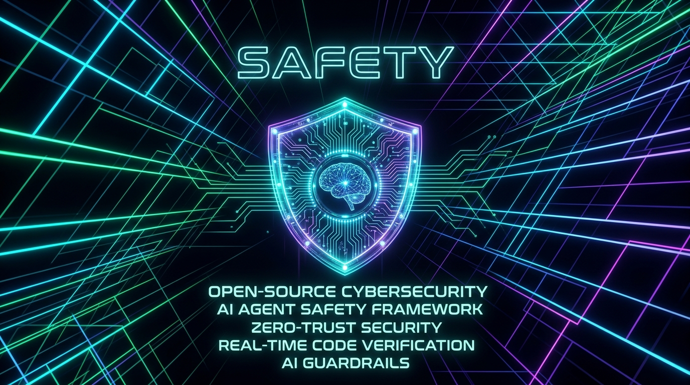
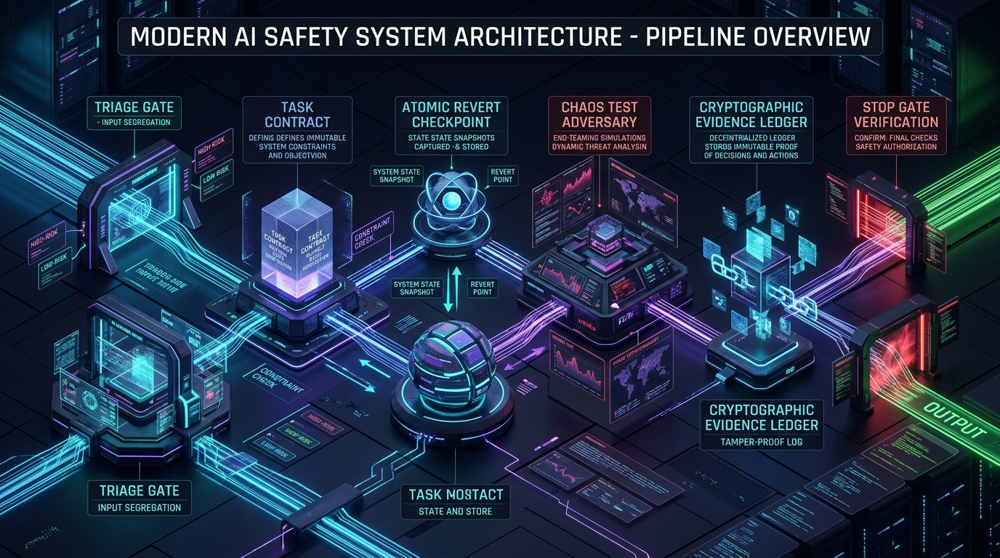
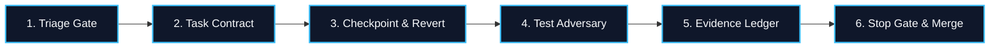

<div align="center">



# 🛡️ SAFETY / MASTER-SKILL

### *The Zero-Trust Autonomous AI Agent Governance & Cognitive Reasoning Engine*

[](https://github.com/dragonkrishnan15/safety/actions)
[](LICENSE)
[](CONTRIBUTING.md)
[](#-universal-compatibility)
[](#-how-it-works-the-zero-trust-pipeline)

<p align="center">
  <b>Converts AI coding assistants from unconstrained token generators into disciplined, sandboxed Principal Engineers.</b><br>
  Enforces immutable task contracts, red-team chaos testing, cryptographic evidence trails, and zero-leak pre-commit stop gates.
</p>

[**🚀 Quickstart**](#-instant-installation) • [**📐 Architecture**](#-architecture--visual-pipeline) • [**⚡ Superpowers**](#-the-core-problem-vs-the-safety-solution) • [**🤖 Supported Agents**](#-universal-compatibility) • [**📋 Templates**](#-production-ready-templates)

</div>

---

## 🖥️ Live Terminal Simulation

<div align="center">
  
</div>

---

## ⚡ The Core Problem vs. The SAFETY Solution

<table>
<tr>
<th width="50%" align="center">❌ Unchecked "Vibe Coding" AI Agents</th>
<th width="50%" align="center">✅ Sandboxed Principal AI with SAFETY</th>
</tr>
<tr>
<td>

- **Hallucinated Passes**: Claims "Fixed and verified!" without ever executing tests.
- **Speculative Patch Stacking**: When tests fail, stacks random edits until code breaks completely.
- **Data Leaks & Secrets**: Commits API keys, local credentials, and internal tokens to GitHub.
- **Scope Creep & Churn**: Refactors untouched files, deletes unrelated tests, and reformats entire directories.
- **Fragile Happy-Path Tests**: Writes trivial mocks that pass locally but implode under real production load.

</td>
<td>

- **Proof-Backed Evidence**: Every assertion must cite a verifiable Evidence ID (`[EV-xxx]`) in `ct-ledger.jsonl`.
- **Atomic Failsafe Rollbacks**: On failure, instantly reverts to clean checkpoint instead of stacking blind edits.
- **Zero-Leak Secret Scanner**: Automatically intercepts API keys (`ghp_`, `sk-`, `AIza`, `AKIA`) before git commits.
- **Strict Contract Boundaries**: Hard blocks unauthorized file writes outside configured `permitted_paths`.
- **The Test Adversary**: Stress-tests code with 30-50 concurrent async workers, poison inputs, and network latency.

</td>
</tr>
</table>

---

## 📐 Architecture & Visual Pipeline

<div align="center">
  
</div>



For complete technical specifications and state transition diagrams, view [**`ARCHITECTURE.md`**](ARCHITECTURE.md).

---

## 🚀 Instant Installation

### Method 1: AI Agent 1-Prompt Auto-Install (Zero Terminal)
Copy and paste this exact prompt directly into **Cursor**, **Claude Code**, **Windsurf**, **Antigravity**, **Cline**, or **GitHub Copilot**:

```text
Install and activate the master-skill framework from https://github.com/dragonkrishnan15/safety.git into my environment by reading AGENT_INSTALL.md in that repository and applying the configuration for my IDE.
```

---

### Method 2: One-Line Terminal Command (Automated)

#### 🪟 Windows (PowerShell):
```powershell
irm https://raw.githubusercontent.com/dragonkrishnan15/safety/main/install.ps1 | iex
```
*Or install globally across all user projects:*
```powershell
& ([scriptblock]::Create((irm https://raw.githubusercontent.com/dragonkrishnan15/safety/main/install.ps1))) -Scope global
```

#### 🍎 macOS / Linux / WSL (Bash):
```bash
curl -fsSL https://raw.githubusercontent.com/dragonkrishnan15/safety/main/install.sh | bash
```
*Or install globally across all user projects:*
```bash
curl -fsSL https://raw.githubusercontent.com/dragonkrishnan15/safety/main/install.sh | bash -s -- --global
```

---

### Method 3: Instant Quickstart Runner
Run the interactive onboarder directly in your local clone:
```powershell
# Windows
.\quickstart.ps1

# macOS / Linux / WSL
bash ./quickstart.sh
```

---

## 🤖 Universal Compatibility

**master-skill / safety** operates natively across all major agent environments with zero code modifications:

| Environment | Adapter Location | Target Activation File | Scope |
|:---|:---|:---|:---|
| **Google Antigravity / Gemini** | `SKILL.md` | `~/.gemini/config/skills/master-skill/` | Global & Workspace |
| **Cursor IDE** | `adapters/.cursorrules` | `.cursor/rules/master-skill.mdc` | Workspace / Project |
| **Windsurf IDE** | `adapters/.windsurfrules` | `.windsurfrules` | Global & Workspace |
| **Anthropic Claude Code** | `adapters/CLAUDE.md` | `./CLAUDE.md` (or `~/.claude/CLAUDE.md`) | Global & Workspace |
| **Cline / Roo Code** | `adapters/.clinerules` | `.clinerules` | Global & Workspace |
| **GitHub Copilot** | `adapters/COPILOT.md` | `.github/copilot-instructions.md` | Workspace |
| **OpenAI Codex / Devin / DeepSeek** | `adapters/AGENTS.md` | `AGENTS.md` | Workspace Root |

---

## ⚡ Interactive Chat Slash Commands

When working in interactive chat environments (Cursor, Claude Code, Antigravity, Windsurf), you can use these shortcuts:

| Command | Action Performed |
|:---|:---|
| **`/master-skill`** (or **`/ms`**) | Forces full zero-trust triage and cognitive reasoning on the active task |
| **`/ms-contract`** | Generates or validates `ct-contract.json` bounds for the current task |
| **`/ms-adversary`** | Injects red-team fault simulations (concurrency, poison inputs, latency drops) |
| **`/ms-stop`** | Executes `scripts/stop_gate` pre-commit audit and renders diff health scorecard |
| **`/ms-report`** | Formats verified report citing Evidence IDs (`[EV-xxx]`) from the ledger |

---

## 📋 Production-Ready Templates

The repository includes ready-to-use production boilerplate templates in [`templates/`](templates/):

- [`contract.template.json`](templates/contract.template.json): Task contract schema specifying permitted paths, forbidden paths, and invariants.
- [`ledger.template.jsonl`](templates/ledger.template.jsonl): Append-only cryptographic evidence ledger.
- [`adversary_test.py`](templates/adversary_test.py): Python red-team suite injecting 30 concurrent workers and poison inputs.
- [`adversary_test.ts`](templates/adversary_test.ts): TypeScript/JavaScript suite testing 50 concurrent async promises under latency.

---

## 🛡️ Security & Zero Data Leakage Policy

1. **Zero Secret Leakage**: The automated stop gate scans additions against patterns for OpenAI, Anthropic, Google, AWS, and private keys.
2. **Local Machine Privacy**: No local drive paths, home directories, or private developer identifiers are ever committed.
3. **No External Runtime Dependencies**: All scripts and verification gates run on pure native PowerShell (Windows) or POSIX sh (macOS/Linux). No pip or npm packages required.

---

<div align="center">

### 🌟 Star this repository on GitHub!
If you believe AI coding agents should be reliable, sandboxed, and disciplined, give this repo a star!

[**GitHub: dragonkrishnan15/safety**](https://github.com/dragonkrishnan15/safety) • [**Issues**](https://github.com/dragonkrishnan15/safety/issues) • [**Contributing Guide**](CONTRIBUTING.md)

Distributed under the [MIT License](LICENSE).

</div>
