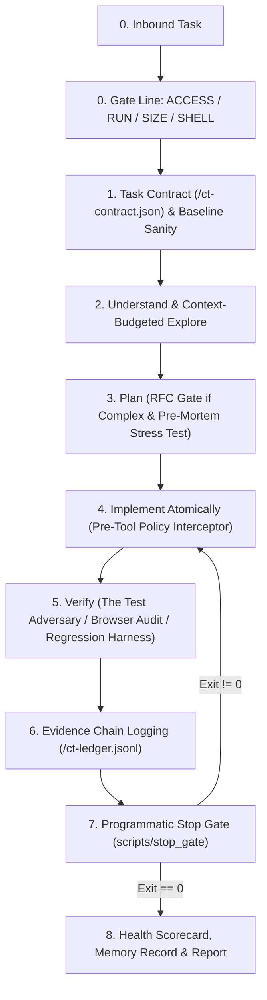

# 🧠 master-skill (v5.1 Apex Zero-Trust Edition)

> **The Principal-Engineer runtime & reasoning framework for ALL AI coding agents and LLM models.**
> Transform reactive, hallucinating code-completion models into disciplined, verification-gated engineering partners.
> Native compatibility with **Claude Code**, **Cursor IDE**, **Windsurf**, **Google Antigravity**, **Cline**, **Roo Code**, **GitHub Copilot**, and **ChatGPT**.

---

<div align="center">

[](LICENSE)
[](.github/workflows/ci.yml)
[](SKILL.md)
[](CONTRIBUTING.md)
[]()
[]()

</div>

---

## ⚡ Quick Comparison: Standard AI vs. `master-skill`

```text
┌─ ❌ Standard AI Coding Assistant ──────────┐ ┌─ 🛡️ master-skill (Zero-Trust Runtime) ───┐
│ • Dumps 2,500-line files into context      │ │ • Slices symbols with tight 30-line margins│
│ • "I fixed the bug! Everything works!"     │ │ • Cites: [EV-001: 18/18 tests pass, exit 0]│
│ • Piles hack-upon-hack on broken tests     │ │ • Clean atomic rollbacks on failed steps   │
│ • Overwrites your uncommitted files        │ │ • Tags dirty files as USER-OWNED (untouched)│
│ • Only tests the happy path                │ │ • Test Adversary injects poison payloads   │
│ • Leaves debug console.log & tags behind   │ │ • Programmatic Stop Gate enforces exit 0   │
└────────────────────────────────────────────┘ └────────────────────────────────────────────┘
```

---

## 📑 Table of Contents
1. [⚡ 3 Ways to Install](#-3-ways-to-install)
   - [Method 1: AI Agent 1-Prompt Auto-Install (Recommended)](#method-1-ai-agent-1-prompt-auto-install-recommended)
   - [Method 2: One-Line Terminal Command (Automated)](#method-2-one-line-terminal-command-automated)
   - [Method 3: Manual File Placement](#method-3-manual-file-placement)
2. [🚀 The Core Zero-Trust Pipeline](#-the-core-zero-trust-pipeline)
3. [🌟 The 14 Superpowers](#-the-14-superpowers)
4. [⌨️ Interactive Slash Commands](#️-interactive-slash-commands)
5. [📁 Production Reference Examples](#-production-reference-examples)
6. [🛠️ Automation Scripts Included](#️-automation-scripts-included)
7. [❓ Frequently Asked Questions (FAQ)](#-frequently-asked-questions-faq)
8. [🤝 Contributing & License](#-contributing--license)

---

## ⚡ 3 Ways to Install

Choose the installation method that fits your workflow:

### Method 1: AI Agent 1-Prompt Auto-Install (Recommended)
You don't need to touch a terminal or copy files manually. Copy and paste this exact prompt directly into **Claude Code**, **Cursor**, **Windsurf**, **Antigravity**, **Cline**, or **GitHub Copilot**:

```text
Install and activate the master-skill framework from https://github.com/CodeStrikerMayank/master_skill.git into my environment by reading AGENT_INSTALL.md in that repository and applying the configuration for my IDE.
```

> **How it works:** The agent reads [`AGENT_INSTALL.md`](AGENT_INSTALL.md), detects its runtime IDE, copies the required rule/skill files, and activates `master-skill` automatically.

---

### Method 2: One-Line Terminal Command (Automated)
Run a single command in your terminal. The installer automatically detects your installed AI tools (Cursor, Claude, Antigravity, Windsurf, Cline) and configures them.

#### 🍎 macOS / Linux / WSL (Bash):
```bash
# Install for current project workspace:
curl -fsSL https://raw.githubusercontent.com/CodeStrikerMayank/master_skill/main/install.sh | bash

# Or install globally across all user projects:
curl -fsSL https://raw.githubusercontent.com/CodeStrikerMayank/master_skill/main/install.sh | bash -s -- --global
```

#### 🪟 Windows (PowerShell):
```powershell
# Install for current project workspace:
irm https://raw.githubusercontent.com/CodeStrikerMayank/master_skill/main/install.ps1 | iex

# Or install globally across all user projects:
& ([scriptblock]::Create((irm https://raw.githubusercontent.com/CodeStrikerMayank/master_skill/main/install.ps1))) -Scope global
```

#### 💻 Windows Command Prompt (CMD):
```cmd
powershell -NoProfile -ExecutionPolicy Bypass -Command "irm https://raw.githubusercontent.com/CodeStrikerMayank/master_skill/main/install.ps1 | iex"
```

*Note: In project mode, the installer also automatically configures a `.git/hooks/pre-commit` quality gate to prevent accidental commits of debug tags.*

---

### Method 3: Manual File Placement
If you prefer total manual control, copy the corresponding adapter file from `adapters/` into your project or user root:

| Environment | Source File in Repo | Target Destination | Scope |
|---|---|---|---|
| **Google Antigravity** | `SKILL.md` + `master-skill.md` | `~/.gemini/config/skills/master-skill/` & `~/.gemini/config/rules/master-skill.md` | Global |
| **Google Antigravity (Project)** | `SKILL.md` + `master-skill.md` | `.agents/skills/master-skill/` & `.agents/rules/master-skill.md` | Workspace |
| **Anthropic Claude Code** | `adapters/CLAUDE.md` | `./CLAUDE.md` (or `~/.claude/CLAUDE.md`) | Workspace / Global |
| **Cursor IDE** | `adapters/.cursorrules` | `./.cursorrules` (or `.cursor/rules/master-skill.mdc`) | Workspace |
| **Windsurf IDE** | `adapters/.windsurfrules` | `./.windsurfrules` | Workspace |
| **Cline / Roo Code** | `adapters/.clinerules` | `./.clinerules` | Workspace |
| **GitHub Copilot** | `adapters/COPILOT.md` | `.github/copilot-instructions.md` | Workspace |
| **ChatGPT / Custom LLM** | `adapters/SYSTEM_PROMPT.md` | Paste into Custom System Instructions | Global |
| **Universal Spec** | `adapters/AGENTS.md` | `./AGENTS.md` | Workspace |

---

## 🚀 The Core Zero-Trust Pipeline



---

## 🌟 The 14 Superpowers

| Superpower | What It Enforces | Documentation |
|---|---|---|
| **Task Contract Engine** | Binds the agent to a formal contract (`ct-contract.json`) with permitted/forbidden paths and invariants before the first edit. | [task-contract.md](references/task-contract.md) |
| **Pre-Tool Interceptor** | Intercepts tool calls before execution; blocks destructive commands (`rm -rf`, `reset --hard`), protected paths, and secret leaks. | [policy-interceptor.md](references/policy-interceptor.md) |
| **The Test Adversary** | Red-team persona attacking its own implementation with poison inputs, rapid concurrency, and boundary limits. | [test-adversary.md](references/test-adversary.md) |
| **Evidence Chain & Ledger** | Immutable append-only event stream (`ct-ledger.jsonl`). Every completion claim MUST cite an Evidence ID (`[EV-xxx]`). | [evidence-chain.md](references/evidence-chain.md) |
| **Programmatic Stop Gate** | Automated exit gate (`scripts/stop_gate`). Session cannot terminate successfully unless automated checks exit with code `0`. | [scripts/stop_gate.ps1](scripts/stop_gate.ps1) |
| **Gate Line** | Instantly sets mode (`read` vs `write`, `interactive` vs `headless`, `pwsh` vs `posix`). | [SKILL.md](SKILL.md) |
| **Baseline Sanity** | Captures git status before touching code. Tags existing dirty files as `USER-OWNED`. | [baseline-env.md](references/baseline-env.md) |
| **Cross-Session Memory** | Recalls repo quirks from `.master-skill/memory.json`; records new lessons upon completion. | [memory.md](references/memory.md) |
| **Token Discipline** | Forbids reading files $>400$ lines. Slices symbols with ~30 lines of margin using ripgrep. | [token-efficiency.md](references/token-efficiency.md) |
| **Pre-Mortem Analysis** | Stress-tests concurrency, drops, poison payloads, and scale before writing code. | [pre-mortem.md](references/pre-mortem.md) |
| **Atomic Rollback** | Saves checkpoint diffs. Reverts cleanly on failure. Max 2 reverts per step. | [rollback.md](references/rollback.md) |
| **Failsafe Circuit Breakers** | Auto-halts after 2 identical command failures or 3 failed approaches. Zero-destruction wall. | [failsafes.md](references/failsafes.md) |
| **Visual Browser Audit** | For Web/UI tasks, launches a browser subagent, audits console for 0 errors, and captures screenshot proof. | [visual-verify.md](references/visual-verify.md) |
| **1-Screen Precision Questions** | One-way doors ask exactly 1 question with context, trade-off matrix, `(Recommended)`, and safe default. | [question-protocol.md](references/question-protocol.md) |

---

## ⌨️ Interactive Slash Commands

When working in interactive chat environments (Claude Code, Antigravity, Cursor, Windsurf), you can use these shortcuts:

| Command | Action |
|---|---|
| `/master-skill` or `/ms` | Launch the full Principal-Engineer pipeline on current prompt. |
| `/ms-contract` | Generate or audit the Task Contract (`<tmp>/ct-contract.json`). |
| `/ms-adversary` | Activate Red-Team Test Adversary fault injection on current diff. |
| `/ms-stop` | Run the Programmatic Stop Gate (`scripts/stop_gate.ps1` / `.sh`). |
| `/ms-report` | Generate the evidence-grounded final scorecard report. |

---

## 📁 Production Reference Examples

Located in [`examples/`](examples/):
- **[`examples/task-contract.example.json`](examples/task-contract.example.json)**: Real-world Task Contract with path boundaries, invariants, and stop gate command.
- **[`examples/ct-ledger.example.jsonl`](examples/ct-ledger.example.jsonl)**: Append-only event stream demonstrating `[EV-001]` through `[EV-004]` evidence capture.
- **[`examples/adversary-test.example.py`](examples/adversary-test.example.py)**: Complete Red-Team adversarial test suite injecting concurrency races, poison payloads, and boundary limits.

---

## 🛠️ Automation Scripts Included

Located in `scripts/`:
- `stop_gate.ps1` / `.sh`: **Programmatic Stop Gate** validating cleanliness, contract boundaries, and test exit codes.
- `fingerprint.ps1` / `.sh`: JSON environment and toolchain detection.
- `leftover_check.ps1` / `.sh`: Scans for leftover `DEBUG-CT` tags and trailing whitespace.
- `flake_runner.ps1` / `.sh`: Batched flake test runner with statistical confidence limits.
- `scorecard.ps1` / `.sh`: Calculates additions/deletions ratio and diff blast radius.
- `memory_sync.ps1` / `.sh`: Appends 1-sentence lessons to `.master-skill/memory.json`.
- `install_hooks.ps1` / `.sh`: Installs git pre-commit safety gate.

---

## ❓ Frequently Asked Questions (FAQ)

#### Q: Does this slow down my AI assistant?
**A:** No. In fact, it often speeds up completion time and cuts API costs by 60–80% because it stops the AI from reading whole 2,000-line files, looping in infinite error cycles, or stacking broken patches.

#### Q: Will this interfere with my existing uncommitted code?
**A:** Never. Law 7 and the Baseline Sanity gate automatically flag all pre-existing dirty files as `USER-OWNED`. The agent is strictly forbidden from editing, staging, stashing, formatting, or reverting them.

#### Q: Do I need Python, Node.js, or Docker to run this?
**A:** No. `master-skill` has **zero external runtime dependencies**. Its automation scripts run on native PowerShell (Windows) or POSIX sh/bash (macOS/Linux).

#### Q: How does the AI know when to stop?
**A:** It cannot stop simply by declaring "Done". It must execute `scripts/stop_gate`, which requires an exit code of `0`, passing all invariant checks and test suites.

---

## 🤝 Contributing & License

We welcome community contributions, additional IDE adapters, and domain playbooks!
Please read our [Contributing Guide](CONTRIBUTING.md) and [Code of Conduct](CODE_OF_CONDUCT.md).

Distributed under the [MIT License](LICENSE). Free and open-source for personal, team, and commercial use.
