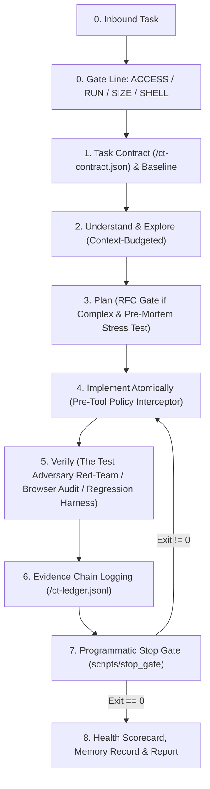

# claude-thinking (v5.1 Apex Architecture Edition)

> **Principal-Engineer reasoning framework for ALL AI coding agents and LLM models.**  
> Compatible with Claude Code, Cursor, Windsurf, Google Antigravity, Cline, Roo Code, GitHub Copilot, ChatGPT, and custom LLM harnesses.

[](LICENSE)
[](.github/workflows/ci.yml)
[](CONTRIBUTING.md)
[]()
[]()

---

## ⚡ 10-Second Auto-Install (Pass this to ANY AI Agent)

You don't need to manually configure files. Copy and paste this prompt to **Claude Code**, **Cursor**, **Windsurf**, **Antigravity**, **Cline**, or **GitHub Copilot**:

```text
Install and activate the claude-thinking framework from https://github.com/CodeStrikerMayank/master_skill.git into my environment by reading AGENT_INSTALL.md in that repository and applying the configuration for my IDE.
```

The agent will read [AGENT_INSTALL.md](AGENT_INSTALL.md) and automatically set up the rules and skills for your exact workspace.

---

## 💻 1-Line Terminal Installation (For Humans & CLI Agents)

### macOS / Linux / WSL (Bash):
```bash
# Install to current project:
curl -fsSL https://raw.githubusercontent.com/CodeStrikerMayank/master_skill/main/install.sh | bash

# Or install globally across all user projects:
curl -fsSL https://raw.githubusercontent.com/CodeStrikerMayank/master_skill/main/install.sh | bash -s -- --global
```

### Windows (PowerShell):
```powershell
# Install to current project:
irm https://raw.githubusercontent.com/CodeStrikerMayank/master_skill/main/install.ps1 | iex

# Or install globally across all user projects:
& ([scriptblock]::Create((irm https://raw.githubusercontent.com/CodeStrikerMayank/master_skill/main/install.ps1))) -Scope global
```

---

## ⚡ What is `claude-thinking`?

Most AI coding assistants suffer from **5 fatal failure modes**:
1. **Blind Overwrites**: Overwriting user files without checking what was there before.
2. **Context Exhaustion**: Dumping massive 2,000-line files into context and running out of tokens.
3. **Patch Stacking**: When code fails, piling hack upon hack instead of rolling back to clean state.
4. **Vague Questions**: Asking lazy questions like *"What should I do next?"* instead of structured recommendations.
5. **No Verification Proof**: Saying *"I fixed it!"* without running tests or checking the browser.

**`claude-thinking` turns any LLM into a disciplined Principal Engineer.** It enforces strict baseline capture, atomic checkpoints, pre-mortem failure mode analysis, real browser audits, token discipline, and zero-destruction failsafes.

---

## 🚀 The Core Workflow Pipeline (Gravitas-Grade Zero-Trust Runtime)



---

## 🌟 The 14 Superpowers (Gravitas-Enhanced)

| Superpower | What It Does | Reference |
|---|---|---|
| **Task Contract Engine** | Binds the agent to a formal contract (`ct-contract.json`) with permitted/forbidden paths and invariants before the first edit. | [task-contract.md](references/task-contract.md) |
| **Pre-Tool Interceptor** | Intercepts tool calls before execution; blocks destructive commands (`rm -rf`, `reset --hard`), protected paths, and secret leaks. | [policy-interceptor.md](references/policy-interceptor.md) |
| **The Test Adversary** | Red-team persona attacking its own implementation with poison inputs, rapid concurrency, and boundary limits. | [test-adversary.md](references/test-adversary.md) |
| **Evidence Chain & Ledger** | Immutable append-only event stream (`ct-ledger.jsonl`). Every completion claim MUST cite an Evidence ID (`[EV-xxx]`). | [evidence-chain.md](references/evidence-chain.md) |
| **Programmatic Stop Gate** | Automated exit gate (`scripts/stop_gate`). Session cannot terminate successfully unless automated checks exit with code `0`. | [scripts/stop_gate.ps1](scripts/stop_gate.ps1) |
| **Gate Line** | Instantly sets mode (`read` vs `write`, `interactive` vs `headless`, `pwsh` vs `posix`). | [SKILL.md](SKILL.md) |
| **Baseline Sanity** | Captures git status before touching code. Tags existing dirty files as `USER-OWNED`. | [baseline-env.md](references/baseline-env.md) |
| **Cross-Session Memory** | Recalls repo quirks from `.claude-thinking/memory.json`; records new lessons upon completion. | [memory.md](references/memory.md) |
| **Token Discipline** | Forbids reading files $>400$ lines. Slices symbols with ~30 lines of margin using ripgrep. | [token-efficiency.md](references/token-efficiency.md) |
| **Pre-Mortem Analysis** | Stress-tests concurrency, drops, poison payloads, and scale before writing code. | [pre-mortem.md](references/pre-mortem.md) |
| **Atomic Rollback** | Saves checkpoint diffs. Reverts cleanly on failure. Max 2 reverts per step. | [rollback.md](references/rollback.md) |
| **Failsafe Circuit Breakers** | Auto-halts after 2 identical command failures or 3 failed approaches. Zero-destruction wall. | [failsafes.md](references/failsafes.md) |
| **Visual Browser Audit** | For Web/UI tasks, launches a browser subagent, audits console for 0 errors, and captures screenshot proof. | [visual-verify.md](references/visual-verify.md) |
| **1-Screen Precision Questions** | One-way doors ask exactly 1 question with context, trade-off matrix, `(Recommended)`, and safe default. | [question-protocol.md](references/question-protocol.md) |

---

## 📦 Universal Adapter Directory

| Agent / IDE | Instruction File | Where to Place |
|---|---|---|
| **Anthropic Claude Code** | [adapters/CLAUDE.md](adapters/CLAUDE.md) | `./CLAUDE.md` or `~/.claude/CLAUDE.md` |
| **Cursor IDE** | [adapters/.cursorrules](adapters/.cursorrules) | `./.cursorrules` or `.cursor/rules/claude-thinking.mdc` |
| **Windsurf IDE** | [adapters/.windsurfrules](adapters/.windsurfrules) | `./.windsurfrules` |
| **Cline / Roo Code** | [adapters/.clinerules](adapters/.clinerules) | `./.clinerules` |
| **GitHub Copilot** | [adapters/COPILOT.md](adapters/COPILOT.md) | `.github/copilot-instructions.md` |
| **Google Antigravity / Gemini CLI** | [SKILL.md](SKILL.md) & [claude-thinking.md](claude-thinking.md) | `~/.gemini/config/skills/` & `~/.gemini/config/rules/` |
| **Universal Generic Agent** | [adapters/AGENTS.md](adapters/AGENTS.md) | `./AGENTS.md` |
| **ChatGPT / Custom LLM** | [adapters/SYSTEM_PROMPT.md](adapters/SYSTEM_PROMPT.md) | Paste into System Instructions |

---

## 🛠️ Automation Scripts Included

Located in `scripts/`:
- `stop_gate.ps1` / `.sh`: **Programmatic Stop Gate** validating cleanliness, contract boundaries, and test exit codes.
- `fingerprint.ps1` / `.sh`: JSON environment and toolchain detection.
- `leftover_check.ps1` / `.sh`: Scans for leftover `DEBUG-CT` tags and trailing whitespace.
- `flake_runner.ps1` / `.sh`: Batched flake test runner with statistical confidence limits.
- `scorecard.ps1` / `.sh`: Calculates additions/deletions ratio and diff blast radius.
- `memory_sync.ps1` / `.sh`: Appends 1-sentence lessons to `.claude-thinking/memory.json`.
- `install_hooks.ps1` / `.sh`: Installs git pre-commit safety gate.

---

## 🤝 Contributing

We welcome community contributions! Please check out [CONTRIBUTING.md](CONTRIBUTING.md) to add new adapters or playbooks.

---

## 📄 License

MIT License. Open source and free for individual developers, teams, and enterprises. See [LICENSE](LICENSE) for details.
