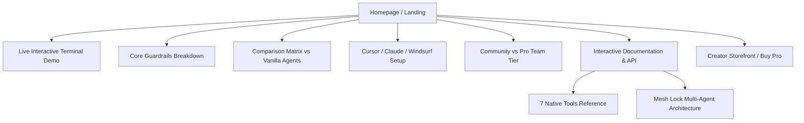

# 🌐 AgentShield / Safety: Website Architecture & Product Blueprint

> **Master Plan, UX Design System, Component Hierarchy, Copywriting, and Tech Stack for the Official Product & Creator Website.**

---

## 1. Executive Summary & Vision

The website will serve as the **official product homepage, documentation hub, interactive playground, and creator storefront** for **AgentShield (`@dragonkrishnan15/safety`)**.

### Primary Objectives:
1. **Instant Trust & WOW Factor:** High-aesthetic dark-mode developer UI inspired by Linear, Vercel, and Stripe with smooth micro-interactions.
2. **Interactive Command Center:** A live in-browser terminal demo letting developers test dangerous commands (`rm -rf /`, `git reset --hard`) and watch the firewall intercept them in real-time.
3. **1-Click Onboarding:** Copy-paste configuration blocks for Cursor, Claude Desktop, Windsurf, and Claude Code.
4. **Creator Storefront & Global Monetization:** Convert visitors into Community users and Pro/Team subscribers paying in USD/INR.
5. **Interactive Docs & MCP Inspector:** Live documentation for all 7 native MCP tools and Mesh Lock synchronization.

---

## 2. Technology Stack & Deployment

| Layer | Recommended Choice | Rationale |
| :--- | :--- | :--- |
| **Framework** | **Astro** or **Next.js 14+ (App Router)** | Instant load speeds (<0.8s LCP), zero-JS markdown docs, optimal SEO. |
| **Styling** | **Vanilla CSS + Modern Tokens** | Ultra-clean glassmorphism, OKLCH color palettes, zero bloated CSS bundles. |
| **Icons & Brand** | **SVG System** | Uses our official `assets/logo.png` & `assets/animated_hero_header.svg`. |
| **Hosting & CI/CD** | **Vercel** or **Cloudflare Pages** | Global edge network with sub-50ms latency in India, US, and Europe. Free tier included. |
| **Domain** | Custom domain (e.g., `agentshield.dev` or `safety-ai.com` or GitHub Pages) | Professional branding for Agensi and MCP Market listings. |
| **Analytics** | **Plausible** or **PostHog** | Privacy-friendly, lightweight, cookieless analytics. |

---

## 3. Brand Identity & Design System

### 🎨 Color Palette (Curated Dark Mode):
- **Background Deep:** `#07090e` (Obsidian Void)
- **Background Surface / Cards:** `#0e131f` (Slate Glass with 1px border `rgba(255,255,255,0.08)`)
- **Primary Accent:** `#10b981` / `#059669` (Cyber Emerald & Safety Green)
- **Secondary Accent:** `#3b82f6` / `#6366f1` (Cobalt & Indigo Mesh)
- **Warning / Threat:** `#ef4444` (Crimson Interceptor Alert)
- **Typography:** Inter / Outfit for headings; JetBrains Mono / Fira Code for terminal & code blocks.

---

## 4. Page Architecture & Sitemap



---

## 5. Detailed Section-by-Section Wireframe & Content

### Hero Section (Above the Fold)
- **Pill Badge:** `🟢 v5.2 Released: Active Governance & Decentralized Mesh Locks`
- **Headline:** `The Security Firewall & Synchronization Mesh for AI Coding Agents.`
- **Subheadline:** `Prevent catastrophic shell commands, quarantine secret leaks, and arbitrate multi-agent file collisions in Claude Desktop, Cursor, and Windsurf.`
- **Call-To-Actions (CTAs):**
  - Primary: `[ 🚀 Quick Install (npx) ]` (Triggers modal or auto-copies `npx -y @dragonkrishnan15/safety install`)
  - Secondary: `[ 📺 Watch 60s Demo ]` / `[ ⭐ View on GitHub (100% Open Source) ]`
- **Hero Visual:** An animated glass terminal showing an AI agent attempting `git reset --hard` and getting blocked with an emerald/crimson interceptor banner.

---

### Interactive Web Terminal (The Playground)
An interactive emulator where visitors can type commands to see the safety response:
- **Preset 1:** `git reset --hard HEAD~1` ➡️ **BLOCKED: Destructive Git rollback prohibited.**
- **Preset 2:** `echo "export OPENAI_API_KEY=sk-proj-94819..."` ➡️ **QUARANTINED: Plaintext secret detected.**
- **Preset 3:** `safety mesh lock src/auth/ --agent "agent-1"` ➡️ **ACQUIRED: File tree locked for 300s.**

---

### Feature Grid: The 4 Defense Pillars
1. **🛡️ Zero-Destruction Shell Wall**
   - Intercepts `rm -rf`, `DROP TABLE`, `mkfs`, and history wipes before the OS executes them.
2. **🔑 12-Pattern Secret Quarantine**
   - Detects AWS, OpenAI, Anthropic, GitHub, Stripe, and private keys from ever being persisted.
3. **🔒 Decentralized Multi-Agent Mesh Locks**
   - Coordinates multi-agent workflows without race conditions via TTL file-tree locks.
4. **📋 Contract-Driven Stop Gates**
   - Enforces green test baselines and deterministic assertions before code writes are allowed.

---

### 1-Click Integration Center (Tabbed Code Switcher)
Tabs for instant configuration:
- **Cursor IDE (`.cursor/mcp.json`)**
- **Claude Desktop (`claude_desktop_config.json`)**
- **Claude Code (`claude mcp add ...`)**
- **Windsurf (`~/.codeium/windsurf/mcp_config.json`)**
- Features a **1-Click Copy** button with active toast notification (`Copied to clipboard!`).

---

### Comparison Matrix: Why Developers Need This

| Scenario | Vanilla Cursor / Claude | With AgentShield / Safety |
| :--- | :--- | :--- |
| **Agent executes `git reset --hard`** | ❌ Destroys hours of uncommitted work | ✅ **BLOCKED** with zero-destruction wall |
| **Agent creates `.env` with live keys** | ❌ Secrets saved in clear text & git | ✅ **QUARANTINED** & alerted |
| **2 Agents editing same file** | ❌ Merge conflicts & overwritten code | ✅ **COLLISION RESOLVED** via mesh locks |
| **Baseline Tests Failing** | ❌ Agent claims "fixed" without proof | ✅ **STOP GATE** blocks untrusted edits |

---

### Pricing & Monetization Section (Global & Indian Market Ready)

```
┌───────────────────────────────────────┐   ┌───────────────────────────────────────┐
│           Community Free              │   │             Pro Developer             │
│                 $0                    │   │        $19 one-time (or $5/mo)        │
│          Forever Open-Source          │   │        For Power Users & Teams        │
├───────────────────────────────────────┤   ├───────────────────────────────────────┤
│ • 7 Native MCP Security Tools         │   │ • Everything in Community Free        │
│ • Zero-Destruction Shell Interceptor  │   │ • Multi-Agent Cloud Mesh Coordinator  │
│ • 12 Plaintext Secret Scanners        │   │ • Custom Enterprise Secret Regex Rules│
│ • Local File Tree Mesh Locks          │   │ • Centralized Audit Telemetry         │
│ • Standard Stdio Protocol Support     │   │ • Priority Feature Request Support    │
│                                       │   │                                       │
│ [ Install Free via NPX ]              │   │ [ Get Pro Access (Stripe / UPI) ]     │
└───────────────────────────────────────┘   └───────────────────────────────────────┘
```

---

### Footer & Social Proof
- Links to GitHub repo (`dragonkrishnan15/safety`), MCP Market storefront, Agensi profile, and Twitter/LinkedIn.
- Built-in Star History live chart widget.
- MIT License badge & Creator attribution.

---

## 6. Implementation Milestones

- [ ] **Phase 1: Project Setup** — Initialize Next.js/Astro project with dark-slate CSS variables.
- [ ] **Phase 2: Hero & Visual Assets** — Integrate `assets/logo.png` and animated hero components.
- [ ] **Phase 3: Interactive Playground** — Build clientside terminal simulation in pure JavaScript.
- [ ] **Phase 4: Integrations & Command Center** — Add tabbed code boxes with clipboard API.
- [ ] **Phase 5: Docs Hub** — Markdown rendering for all 7 tools and CLI scripts.
- [ ] **Phase 6: Deployment & SEO** — Deploy to Vercel/Cloudflare Pages with OpenGraph preview cards.
